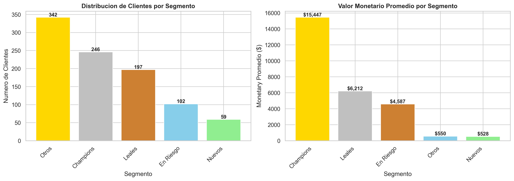
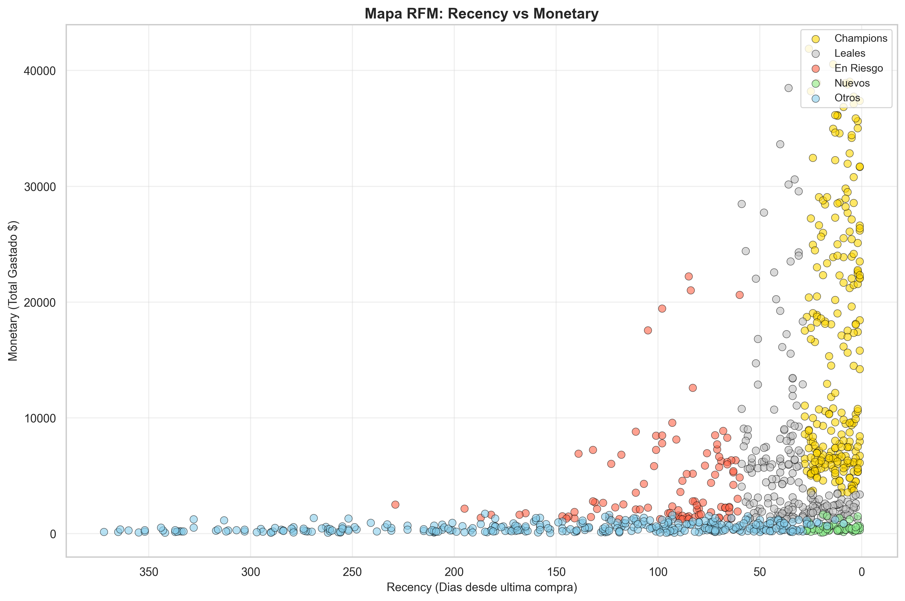
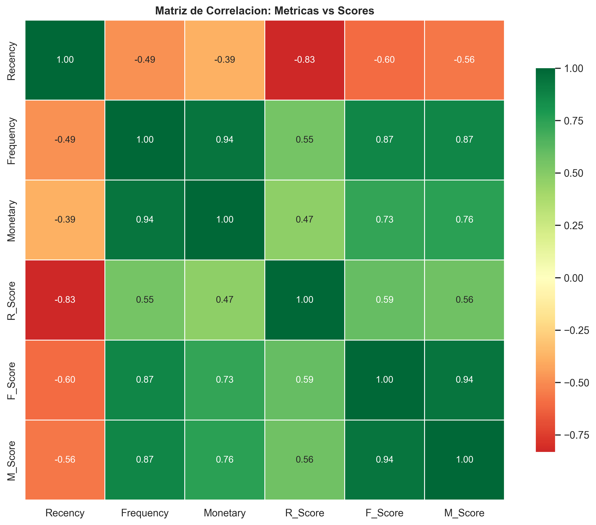

English version: [README.en.md](README.en.md)

# Segmentación de clientes RFM · comercio electrónico

Divide una cartera de clientes en cinco grupos según lo reciente, lo frecuente y lo mucho que compran, y propone
una acción comercial para cada grupo.

**Resultado:** los 246 mejores clientes son el 26 % de la cartera y el 66,5 % de las ventas. En el otro extremo, 401
clientes, el 42 % de la cartera, suman el 3,8 % de las ventas.

```bash
pip install -r requirements.txt
jupyter notebook 01_Analisis_RFM_Completo.ipynb
```

Los datos son sintéticos: 946 clientes y 7.741 pedidos de doce meses, generados por el propio repositorio con
`Script_Datos_Sinteticos.ipynb`.

## El problema

Un equipo comercial no puede llamar a todos los clientes cada semana, y casi siempre ordena por facturación. Ese
orden esconde al cliente valioso que ha dejado de comprar. En estos datos, el cliente 1029 compró veintidós veces y
dejó 20.637 dólares, y lleva dos meses sin volver. El acumulado anual lo pone arriba y no avisa de que se está
yendo.

## El método

**RFM** son las iniciales inglesas de recencia, frecuencia e importe. Por cada cliente se calculan tres números:
- recencia: días desde la última compra;
- frecuencia: número de compras;
- importe: dinero gastado en total.

Cada número se puntúa del 1 al 5 por quintiles, es decir, cortando la cartera ordenada en cinco partes iguales. Así
los cortes salen de los propios datos y no de un umbral puesto a ojo:

| Corte | Recencia | Frecuencia | Importe |
|---|---|---|---|
| p20 | 13 días | 2 compras | 405 $ |
| p40 | 28 días | 4 compras | 1.246 $ |
| p60 | 59 días | 7 compras | 3.537 $ |
| p80 | 121 días | 13 compras | 8.489 $ |

Las tres puntuaciones forman un código, y el código decide el grupo con la primera regla que cumple:

```
Champions → R>=4, F>=4, M>=4
Leales    → R>=3, F>=3, M>=3
Nuevos    → R>=4, F<=2
En riesgo → R<=2, F>=3, M>=3
Otros     → el resto
```

## Los cinco grupos

| Segmento | Clientes | % | Gasto medio | Días sin comprar | Compras |
|----------|----------|---|-------------|------------------|---------|
| Champions | 246 | 26 % | 15.447 $ | 12 | 16,8 |
| Leales | 197 | 21 % | 6.212 $ | 33 | 9,3 |
| En riesgo | 102 | 11 % | 4.587 $ | 96 | 8,1 |
| Nuevos | 59 | 6 % | 528 $ | 13 | 2,5 |
| Otros | 342 | 36 % | 550 $ | 144 | 2,3 |



Un cliente Champions gasta de media 2,5 veces más que uno Leal y 28 veces más que uno del grupo Otros.



El mapa cruza los días sin comprar con el dinero gastado. Arriba a la derecha están los Champions; a la izquierda,
los que llevan meses sin volver.

## Las acciones propuestas

- Champions: programa de clientes preferentes, con acceso anticipado y un gestor de cuenta.
- En riesgo: campaña de recuperación de 30 días con un descuento y anuncios a quien ya visitó la tienda.
- Nuevos: acompañamiento de los primeros 90 días con correos automáticos y un descuento creciente.

## Cómo se ha comprobado

El cuaderno pasa nueve verificaciones sobre su propio resultado antes de dibujar nada; por ejemplo, que los
Champions lleven de media menos de treinta días sin comprar. Las tres correlaciones entre cada puntuación y su número
de origen salen en el sentido esperado: recencia −0,83, frecuencia 0,87 e importe 0,76.



Las cifras de esta página se recalcularon con un programa aparte que lee los pedidos sin pandas, y coinciden. Los
dos cuadernos se ejecutan de principio a fin en un entorno nuevo instalado solo con `requirements.txt`, y el
generador reproduce el fichero de datos idéntico.

## Límites

- Los datos son inventados. Sirven para enseñar el método sin publicar clientes reales.
- RFM solo mira ventas. No sabe el margen de cada producto ni el coste de atender a cada cliente, ni por qué se fue
  alguien.
- El corte por quintiles se mueve cuando cambia la cartera, y dos clientes casi iguales pueden caer a lados
  distintos: con 60 días sin comprar, el cliente 1029 sale En riesgo, y el 1120, con 59 días y las mismas compras,
  sale Leal.

## Ficheros

| Fichero | Qué contiene |
|---|---|
| `01_Analisis_RFM_Completo.ipynb` | el análisis completo: puntuación, segmentación, verificaciones y gráficos |
| `Script_Datos_Sinteticos.ipynb` | el generador de los datos |
| `raw_data_12meses.csv` | los 7.741 pedidos de doce meses |
| `raw_data.csv` | los datos de partida del generador |
| `requirements.txt` | las bibliotecas necesarias |

## Repositorios relacionados

- [lead-scoring-ml](https://github.com/jleonceo/lead-scoring-ml): ordenar contactos comerciales por su probabilidad
  de compra.
- [de-datos-en-bruto-a-decisiones](https://github.com/jleonceo/de-datos-en-bruto-a-decisiones): un fichero de ventas
  en bruto convertido en respuestas de negocio y en un cuadro de mando.
- [analisis-contable](https://github.com/jleonceo/analisis-contable): análisis financiero de una empresa, del libro
  diario a las conclusiones.

---

*Parte del portfolio de [Juan Luis León](https://github.com/jleonceo) · [juanluisleon.vercel.app](https://juanluisleon.vercel.app) · Licencia [MIT](LICENSE)*
